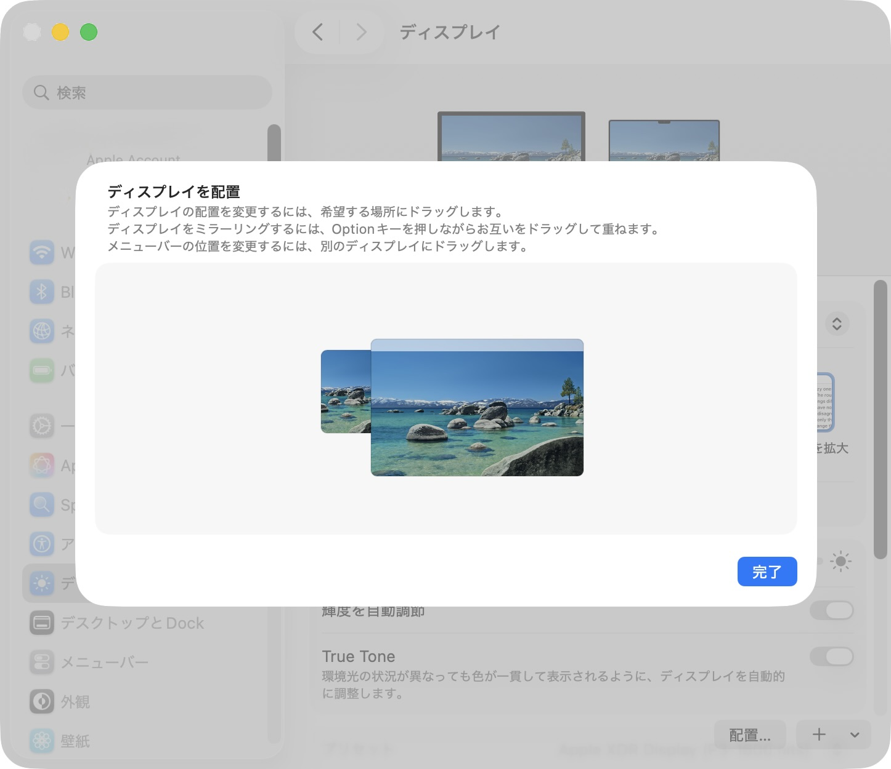
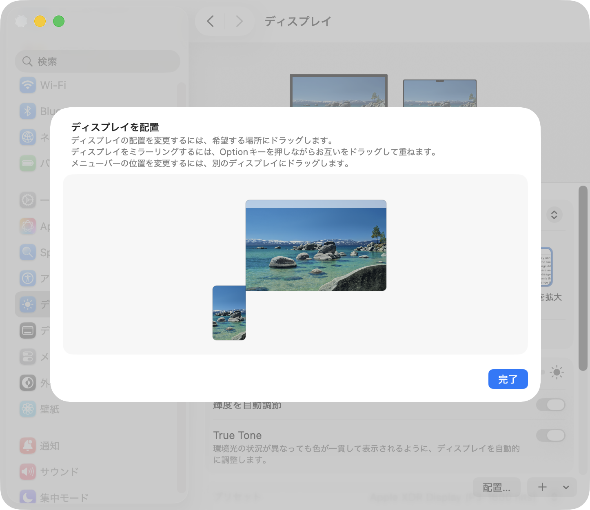

[English](README.md) | [日本語](README.ja.md)

# CommandoTab

マウスカーソルのいるモニターに表示される **Command+Tab 代替アプリスイッチャー**（macOS）。

macOS 標準の Command+Tab はマルチモニター環境では、感覚とずれたディスプレイにスイッチャーが表示され、非常に使いづらく感じます。CommandoTab は標準の Command+Tab を乗っ取り、**常にマウスカーソルのあるモニター**に自前のスイッチャーを表示します。

さらに **Dockの監獄** を ON にすると、標準の Dock をメインディスプレイから追い出せます（仮想ディスプレイを使います）。高機能ドックやランチャーを使っていて、標準の Dock が邪魔なときに便利です。

## ダウンロード

1. [Releases](../../releases/latest) から最新の `CommandoTab-<バージョン>.zip` をダウンロード
2. zip を展開し、`CommandoTab.app` を `アプリケーション` フォルダーへ移動
3. 初回起動時に **アクセシビリティ権限** を求められます
   - システム設定 → プライバシーとセキュリティ → アクセシビリティ で **CommandoTab を許可**し、アプリを再起動してください（Command+Tab のキー入力を傍受するために必要です）
4. 設定変更後、一度アプリケーションを終了し、再度起動すると確実です。

Apple の公証（Notarization）済みのため、Gatekeeper の警告なしに起動できます。

Homebrew でもインストールできます。

```bash
brew install --cask EVAtiter/tap/commandotab
```

Homebrew 7 以降で「untrusted tap」と表示されたら、先に次のコマンドで commandotab を信頼してから、もう一度インストールしてください。

```bash
brew trust --cask evatiter/tap/commandotab
```

## 操作方法

| 操作 | 動作 |
|------|------|
| `Command + Tab` | スイッチャー表示 / 次のアプリへ |
| `Command + Shift + Tab` | 前のアプリへ |
| `Command` を離す | 選択中のアプリに切り替えて確定 |
| `Esc`（表示中） | 取消 |
| マウス | アイコンにホバーで選択、クリックで確定 |
| `Control + Option + Command + M` | 最小化ウィンドウをすべて復元 |

切り替え対象は **MRU（最近使った順）** で並びます（標準 Command+Tab と同じ）。
カレンダー.app のアイコンは、本物の Dock と同じく **当日の日付** で表示されます。

## 主な機能

- 常に**マウスカーソルのあるモニター**にスイッチャーを表示（マルチモニター対応）
- macOS 標準スイッチャーと同じ見た目（半透明ブラー・選択ハイライト・名前ラベル・アイコン 128pt）
- MRU（最近使った順）でアプリを並べる
- マウスによる直接選択・クリック確定
- メニューバー常駐（Dock には出ません）、ログイン時に開く設定あり
- **⌘M / ⌘⌥M（ウィンドウ最小化）の無効化**（メニュー「⌘Mで最小化させない」。既定で ON）
- **最小化ウィンドウをすべて復元**（メニュー・⌃⌥⌘M・スイッチャー右上のボタン）
- **Dockの監獄**：標準 Dock をメインディスプレイから追い出す（仮想ディスプレイへ。高機能ドック併用時に便利）
- 日本語 / 英語対応（システムの言語が日本語以外なら英語で表示）

## Dockの監獄：メインディスプレイから標準の Dock を隠す

QuickQuay のような高機能ドック／ランチャーを使っていると、macOS 標準の Dock はむしろ邪魔になります（最小化は CommandoTab の「⌘Mで最小化させない」で抑制でき、ゴミ箱も高機能ドック側で代替できます）。ところが macOS には「標準 Dock を特定ディスプレイに出さない」設定がありません。

そこで CommandoTab は “左の拡張ディスプレイ” を**仮想ディスプレイ（＝Dockの監獄）**として自前で用意します。メニュー「Dockの監獄（仮想ディスプレイ）」を ON にし、システム設定でそれを一番左へ配置＋Dock 位置を「左」にすると、標準 Dock と標準 Command+Tab スイッチャーがメインから消えます（手順はメニュー「Dockの監獄の使い方…」で案内）。対処療法的ですが実質的な解決策です。

- 仮想ディスプレイに入り込んだウィンドウは、メイン画面へ自動で引き戻します
- 仮想ディスプレイへのドロップやクリックは受け付けません
- ディスプレイのミラーリング中・リモートセッション中は一時停止します（メニューに表示されます）
- 監獄に入れた Dock から最小化ウィンドウを取り出すには「最小化ウィンドウをすべて復元」を使います

**基本の配置**（仮想ディスプレイを左に並べる）:



**配置のコツ**: 仮想ディスプレイはできるだけ**下げて**置き、メイン画面の左端と重なる長さを小さくします（ただし**角だけの接触にはしない**）。重なりが小さいほど、マウスカーソルが左端を越えて仮想ディスプレイ側へ消えにくくなります。



## 動作環境

- **対応 OS**: macOS 13 Ventura 以降
- **アーキテクチャ**: Apple Silicon（arm64）専用（Intel Mac には非対応）
- **署名**: Apple 公証済み（Notarized Developer ID）

## ライセンス / 開発

Copyright © 2026 EVA Titer. All rights reserved.
