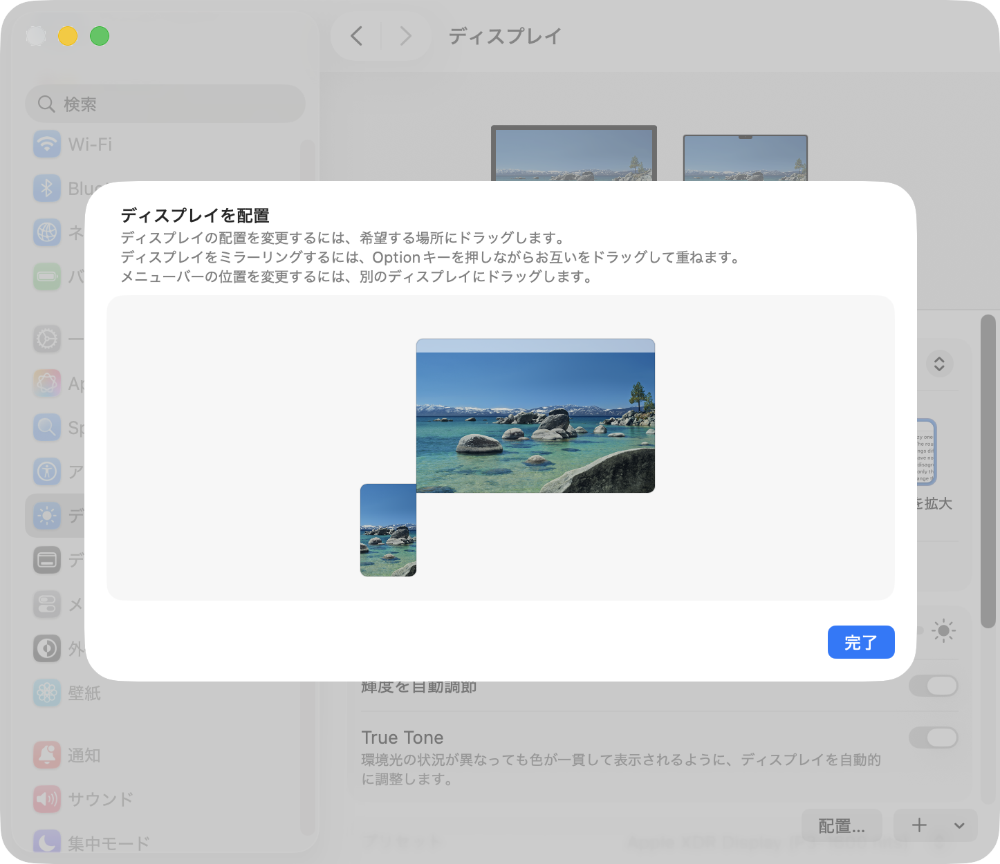

[English](README.md) | [日本語](README.ja.md)

# CommandoTab

A **Command+Tab app-switcher replacement** for macOS that always appears on the monitor where your cursor is.

On multi-monitor setups, the built-in Command+Tab switcher shows up on a display that doesn't match your intuition, which feels awkward. CommandoTab takes over the standard Command+Tab and always shows its own switcher **on the monitor under your mouse cursor**.

Turn on **Dock Jail** and you can also push the standard Dock off your main display (using a virtual display) — handy when you use a high-function dock or launcher and the standard Dock just gets in the way.

## Download

1. Download the latest `CommandoTab-<version>.zip` from [Releases](../../releases/latest).
2. Unzip it and move `CommandoTab.app` to your `Applications` folder.
3. On first launch you'll be asked for **Accessibility permission**.
   - Go to System Settings → Privacy & Security → Accessibility, **enable CommandoTab**, then relaunch the app (required to intercept the Command+Tab key input).
4. After changing the setting, quitting and relaunching the app once makes it take effect reliably.

The app is **notarized by Apple**, so it launches without Gatekeeper warnings.

You can also install it with Homebrew.

```bash
brew install --cask EVAtiter/tap/commandotab
```

If Homebrew 7 or later reports an "untrusted tap", trust commandotab first with the command below, then install again.

```bash
brew trust --cask evatiter/tap/commandotab
```

## Usage

| Action | Behavior |
|--------|----------|
| `Command + Tab` | Show switcher / move to next app |
| `Command + Shift + Tab` | Move to previous app |
| Release `Command` | Switch to the selected app |
| `Esc` (while shown) | Cancel |
| Mouse | Hover to select, click to confirm |
| `Control + Option + Command + M` | Restore all minimized windows |

Apps are ordered by **MRU (most recently used)**, just like the standard Command+Tab.
The Calendar.app icon shows **today's date**, just like the real Dock.

## Features

- Always shows the switcher **on the monitor under your mouse cursor** (multi-monitor friendly)
- Looks the same as the standard macOS switcher (translucent blur, selection highlight, app-name label, 128pt icons)
- Orders apps by MRU (most recently used)
- Direct selection and click-to-confirm with the mouse
- Lives in the menu bar (not shown in the Dock), with an "Open at Login" option
- **Disable ⌘M / ⌘⌥M (window minimize)** via the menu item "Disable ⌘M Minimize" (on by default)
- **Restore All Minimized Windows** (from the menu, with ⌃⌥⌘M, or with the button at the top right of the switcher)
- **Dock Jail**: push the standard Dock off your main display (onto a virtual display — handy alongside a high-function dock)
- English / Japanese (shown in Japanese when the system language is Japanese, otherwise in English)

## Dock Jail: hide the standard Dock from your main display

If you use a high-function dock/launcher such as QuickQuay, the standard macOS Dock tends to just get in the way (minimizing can be suppressed with CommandoTab's "Disable ⌘M Minimize", and the Trash can be replaced by your high-function dock). However, macOS has no setting to "not show the standard Dock on a specific display."

So CommandoTab creates that "left extended display" itself, as a **virtual display** (a "Dock Jail"). Turn on "Dock Jail (Virtual Display)" from the menu, place that virtual display at the far left in System Settings, and set the Dock position to "Left" — then the standard Dock and the standard Command+Tab switcher disappear from your main display (the steps are explained in the menu item "How to Use Dock Jail…"). It's a workaround, but a practically effective one.

- Windows that wander onto the virtual display are automatically moved back to your main display
- The virtual display does not accept drops or clicks
- Dock Jail pauses while displays are mirrored or during a remote session (shown in the menu)
- To get minimized windows back out of the jailed Dock, use "Restore All Minimized Windows"

**Basic arrangement** (place the virtual display to the left):


**Tip**: place the virtual display as low as possible so it overlaps the left edge of your main display only slightly (but keep some overlap — not just corner-to-corner). The smaller the overlap, the less your cursor slips past the left edge into the virtual display.



## Requirements

- **OS**: macOS 13 Ventura or later
- **Architecture**: Apple Silicon (arm64) only (Intel Macs are not supported)
- **Signing**: Notarized by Apple (Developer ID)

## License / Author

Copyright © 2026 EVA Titer. All rights reserved.
